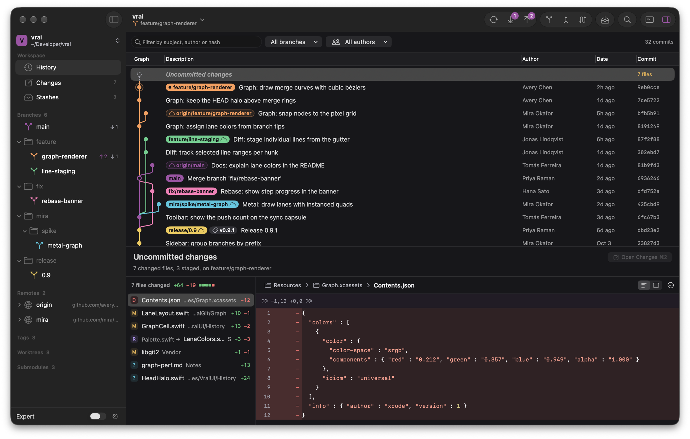
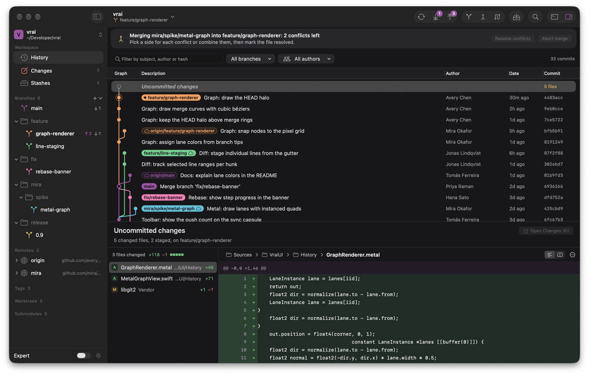
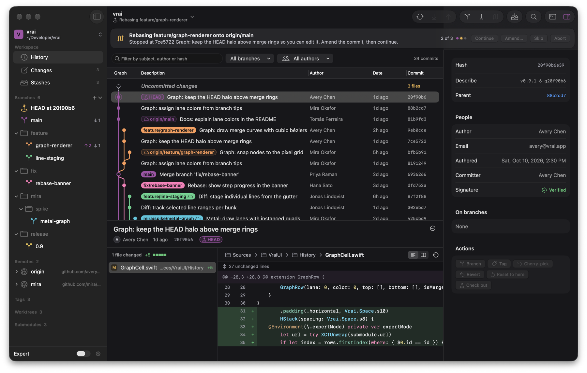
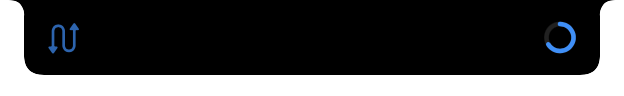
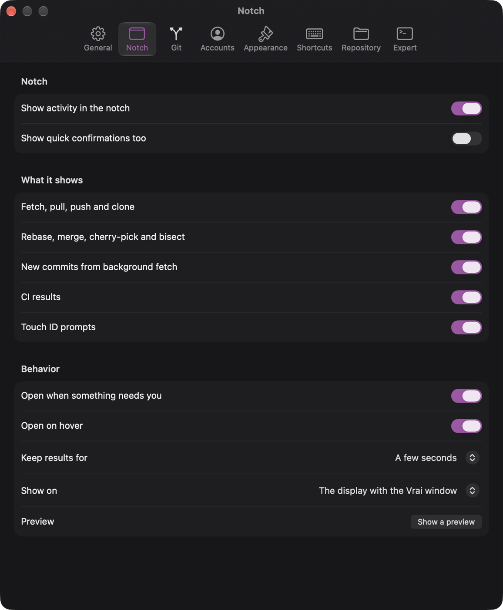

<p align="center">
  
</p>

<h3 align="center">A native Git client for macOS</h3>

<p align="center">
  Fast on huge repositories, honest about every command it runs,<br>
  and built entirely with SwiftUI and AppKit.
</p>

<p align="center">
  <a href="https://github.com/aaravmaloo/vrai/releases/latest"></a>
  <a href="https://github.com/aaravmaloo/vrai/actions/workflows/tests.yml"></a>
  <a href="https://github.com/aaravmaloo/vrai/releases"></a>
  
  
  <a href="LICENSE"></a>
</p>

<p align="center">
  <a href="https://github.com/aaravmaloo/vrai/releases/latest"><b>Download</b></a>
  &nbsp;&middot;&nbsp;
  <a href="#install">Install</a>
  &nbsp;&middot;&nbsp;
  <a href="#a-tour-of-vrai">Tour</a>
  &nbsp;&middot;&nbsp;
  <a href="#keyboard-shortcuts">Shortcuts</a>
  &nbsp;&middot;&nbsp;
  <a href="#faq">FAQ</a>
  &nbsp;&middot;&nbsp;
  <a href="#development">Development</a>
</p>

<br>

<picture>
  <source media="(prefers-color-scheme: dark)" srcset="docs/history-dark.png">
  <source media="(prefers-color-scheme: light)" srcset="docs/history-light.png">
  
</picture>

<br>

Vrai is a Git client that feels like it shipped with your Mac. It drives the
git you already have instead of a bundled reimplementation, so everything it
does is a real git command, shown in the console as it runs. You get a graph
that keeps up with repositories of any size, careful handling of anything
destructive, and CI results right next to your commits.

## Highlights

<table>
  <tr>
    <td width="33%" valign="top">
      <b>A graph that keeps up</b><br>
      Scrolls through hundreds of thousands of commits without stutter, with
      colored lanes that stay stable as history grows.
    </td>
    <td width="33%" valign="top">
      <b>Line-level staging</b><br>
      Stage a file, a hunk or a single line, then commit with
      <kbd>⌘</kbd><kbd>↩</kbd>.
    </td>
    <td width="33%" valign="top">
      <b>History editing without fear</b><br>
      Drag to reorder an interactive rebase, resolve conflicts in place, and
      undo the result if it went wrong.
    </td>
  </tr>
  <tr>
    <td valign="top">
      <b>CI where you work</b><br>
      GitHub checks and Actions runs appear beside every commit and branch,
      and Vrai tells you when a push turns red.
    </td>
    <td valign="top">
      <b>Lives in the notch</b><br>
      Fetches, pushes and paused rebases show up as quiet icons around the
      notch, and open only when they need you.
    </td>
    <td valign="top">
      <b>Touch ID for risky actions</b><br>
      Force pushes and other destructive operations ask for your
      fingerprint before they run.
    </td>
  </tr>
</table>

## Install

### Homebrew

```sh
brew install --cask aaravmaloo/tap/vrai
```

### Direct download

1. Download `Vrai-<version>.dmg` from the [latest release](https://github.com/aaravmaloo/vrai/releases/latest).
2. Open it and drag **Vrai** into **Applications**.

> [!NOTE]
> Vrai is not notarized yet, so macOS blocks the first launch. Open
> **System Settings › Privacy & Security**, find the message about Vrai and
> click **Open Anyway**. You only need to do this once.

### Requirements

| | |
| --- | --- |
| **macOS** | 26 Tahoe or later |
| **Processor** | Apple silicon or Intel (universal binary) |
| **git** | 2.45 or later, from Apple's command line tools or Homebrew |

Vrai uses the git it finds on your Mac, preferring Homebrew's when both are
installed. You can point it at a different binary in **Settings › Git**.

### Updates

Vrai updates itself with [Sparkle](https://sparkle-project.org). It checks in
the background, shows the release notes before installing, and verifies every
download against an EdDSA signature. Choose **Vrai › Check for updates** to
check right away. Homebrew installs update the same way.

## A tour of Vrai

### History

The history view pairs the commit graph with a filter for message, author or
hash, plus menus to narrow it to one branch or one author.

- Branch, tag and remote labels sit on each commit, colored to match their lane
- The inspector shows authorship, signatures, the branches containing a commit and quick actions
- File history, blame and the reflog are a click away from any file or commit
- Commits can be copied, tagged, branched from, cherry-picked, reverted or checked out from the context menu

### Changes and committing

- Stage and unstage whole files, single hunks or individual lines from the gutter
- Unified or side-by-side diffs, with optional whitespace display and line wrapping
- Commit with <kbd>⌘</kbd><kbd>↩</kbd>, or commit and push with <kbd>⌥</kbd><kbd>⌘</kbd><kbd>↩</kbd>
- Amend the last commit, and sign commits and tags with an SSH key chosen in Settings
- Discard changes knowing they can be brought back with <kbd>⌘</kbd><kbd>Z</kbd>

### Branches, remotes and sync

- Create, switch, rename, track, publish and delete branches, grouped by prefix in the sidebar
- Fetch, pull and push from the toolbar, with ahead and behind counts on every branch
- Pull by merging or rebasing, and set uncommitted work aside automatically while pulling
- Force push only ever uses `--force-with-lease`
- When a switch would overwrite local changes, choose to stash them or carry them along
- Background fetch on your schedule, with a notification when tracked branches move

### Merging, rebasing and conflicts

<table>
  <tr>
    <td width="50%"></td>
    <td width="50%"></td>
  </tr>
  <tr>
    <td align="center"><sub>A merge paused on conflicts</sub></td>
    <td align="center"><sub>A rebase stopped for an edit, step 2 of 3</sub></td>
  </tr>
</table>

- Interactive rebase where you drag commits into order and pick, reword, edit, squash, fixup or drop each one, using the same single-key shortcuts as git's todo list
- Drop a branch onto the current one to merge it or rebase onto it
- Merges, rebases, cherry-picks and reverts that stop on a conflict show a banner with what is left and how to continue
- A conflict pane to take either side or combine them, with git's recorded resolutions reused when you enable them
- Bisect with good, bad and skip, a running count of steps left and the first bad commit when it is found

### Undo and safety

- Undo deleted branches and tags, dropped stashes, discarded files or lines, a clean and a rebase
- An undo history lists what can still be restored
- Touch ID before force pushing, deleting a remote branch, cleaning without a backup, deleting saved passwords and signing out
- Expert mode marks commands that rewrite or discard work before you run them

### CI status

- Check runs, GitHub Actions workflow runs and commit statuses beside every commit in the history and every branch in the sidebar
- A popover lists each check with its duration and summary, and opens it on GitHub
- After a push, Vrai follows the checks and tells you when they pass or fail
- Failed jobs can be re-run from the app
- Works with GitHub and GitHub Enterprise, using your `gh` login, `GH_TOKEN` or the token git already has for the host

### The notch

<p align="center">
  
</p>

On Macs with a notch, Vrai turns it into a status area in the style of the
Dynamic Island. A fetch, pull or push shows a ring that fills as git works.
A paused rebase, merge or bisect stays beside the notch until it is done.
Nothing expands unless a decision is needed, such as a rejected push or a
failing build, and hovering shows the details and the actions that apply.

On Macs without a notch the same activity appears as a small pill at the top
of the screen.

<details>
<summary><b>Notch settings</b></summary>
<br>
<p align="center">
  
</p>

Choose what appears in the notch, whether it opens on hover or only on click,
how long results stay, and which display it uses.
</details>

### Everything else

- **Command palette.** <kbd>⌘</kbd><kbd>K</kbd> reaches every command, branch and setting.
- **Console.** <kbd>⌘</kbd><kbd>J</kbd> shows every git command Vrai ran, with its output and exit code.
- **Expert mode.** Command previews in every sheet, a git prompt in the console, Reflog and Refs in the sidebar, and tools that rewrite history.
- **Stashes, worktrees and submodules,** each with their own view.
- **Repository settings.** A per-repository identity, hooks, Git LFS status and background maintenance.
- **Accounts.** Sign in to HTTPS hosts when git asks, manage SSH keys and choose a signing key.

## Keyboard shortcuts

<details>
<summary>Show all shortcuts</summary>
<br>

| Action | Shortcut |
| --- | --- |
| Command palette | <kbd>⌘</kbd> <kbd>K</kbd> |
| Filter history | <kbd>⌘</kbd> <kbd>F</kbd> |
| History, Changes, Stashes, Reflog | <kbd>⌘</kbd> <kbd>1</kbd> to <kbd>4</kbd> |
| Show console | <kbd>⌘</kbd> <kbd>J</kbd> |
| Show inspector | <kbd>⌥</kbd> <kbd>⌘</kbd> <kbd>0</kbd> |
| Hide sidebar | <kbd>⌃</kbd> <kbd>⌘</kbd> <kbd>S</kbd> |
| Switch repository | <kbd>⌘</kbd> <kbd>T</kbd> |
| Open repository | <kbd>⌘</kbd> <kbd>O</kbd> |
| Clone repository | <kbd>⇧</kbd> <kbd>⌘</kbd> <kbd>O</kbd> |
| New repository | <kbd>⌥</kbd> <kbd>⌘</kbd> <kbd>N</kbd> |
| Commit | <kbd>⌘</kbd> <kbd>↩</kbd> |
| Commit and push | <kbd>⌥</kbd> <kbd>⌘</kbd> <kbd>↩</kbd> |
| Undo, Redo | <kbd>⌘</kbd> <kbd>Z</kbd>, <kbd>⇧</kbd> <kbd>⌘</kbd> <kbd>Z</kbd> |
| Fetch | <kbd>⇧</kbd> <kbd>⌘</kbd> <kbd>F</kbd> |
| Fetch all remotes and prune | <kbd>⌥</kbd> <kbd>⇧</kbd> <kbd>⌘</kbd> <kbd>F</kbd> |
| Pull | <kbd>⇧</kbd> <kbd>⌘</kbd> <kbd>L</kbd> |
| Pull with rebase | <kbd>⌥</kbd> <kbd>⇧</kbd> <kbd>⌘</kbd> <kbd>L</kbd> |
| Push | <kbd>⇧</kbd> <kbd>⌘</kbd> <kbd>P</kbd> |
| Force push with lease | <kbd>⌥</kbd> <kbd>⇧</kbd> <kbd>⌘</kbd> <kbd>P</kbd> |
| Stash changes | <kbd>⇧</kbd> <kbd>⌘</kbd> <kbd>S</kbd> |
| Switch branch | <kbd>⌘</kbd> <kbd>B</kbd> |
| New branch | <kbd>⇧</kbd> <kbd>⌘</kbd> <kbd>B</kbd> |
| Merge into current branch | <kbd>⇧</kbd> <kbd>⌘</kbd> <kbd>M</kbd> |
| Rebase current branch | <kbd>⇧</kbd> <kbd>⌘</kbd> <kbd>R</kbd> |
| Interactive rebase | <kbd>⌥</kbd> <kbd>⇧</kbd> <kbd>⌘</kbd> <kbd>R</kbd> |
| Copy full commit hash | <kbd>⌥</kbd> <kbd>⌘</kbd> <kbd>C</kbd> |
| Expert mode | <kbd>⌥</kbd> <kbd>⌘</kbd> <kbd>E</kbd> |
| Welcome window | <kbd>⇧</kbd> <kbd>⌘</kbd> <kbd>1</kbd> |

Every shortcut is also listed in **Settings › Shortcuts**.
</details>

## Settings

<details>
<summary>What each pane covers</summary>
<br>

| Pane | Covers |
| --- | --- |
| **General** | Welcome window, background fetch and its interval, new commit notifications, GitHub checks, console behavior, terminal app |
| **Notch** | What the notch shows, when it opens, how long results stay, which display it uses |
| **Git** | First branch name, pull strategy, reused conflict resolutions, force push confirmation, Touch ID, diff algorithm, rename detection, git binary |
| **Accounts** | Signed in hosts, SSH keys, commit and tag signing, your name and email |
| **Appearance** | Light or dark, density, code size, whitespace, line wrapping, sidebar and inspector defaults |
| **Shortcuts** | Every keyboard shortcut in one place |
| **Repository** | Identity for this repository, hooks, Git LFS, background maintenance |
| **Expert** | Expert mode, command previews, git configuration |
</details>

## Privacy

Vrai has no accounts, analytics or telemetry. It talks to the network only
when one of these applies:

- **Your remotes,** through git itself, whenever you fetch, pull, push or clone.
- **The GitHub API,** to read CI checks for repositories hosted on GitHub. Turn this off in **Settings › General**.
- **GitHub Releases,** where Sparkle looks for updates.

Credentials stay with git's credential helper and your keychain.

## FAQ

<details>
<summary><b>Why does Vrai need macOS 26?</b></summary>
<br>
Vrai is built on the current SwiftUI and AppKit, including the Liquid Glass
materials introduced in macOS 26. Supporting older releases would mean
maintaining a second interface.
</details>

<details>
<summary><b>Does it work with GitLab, Bitbucket or my own server?</b></summary>
<br>
Yes. Everything git can do works with any host. CI status is currently
GitHub and GitHub Enterprise only.
</details>

<details>
<summary><b>Will Vrai change my repositories in ways git would not?</b></summary>
<br>
No. Every change is made by running git, and the console shows the exact
command. The only things Vrai adds are for undo: a small journal in
`.git/vrai/` and backup refs under `refs/vrai/undo/`. Both live inside git's
own folder, never in your working tree, and are not pushed.
</details>

<details>
<summary><b>Can I keep using the command line alongside it?</b></summary>
<br>
Yes. Vrai watches the repository and picks up changes made anywhere, whether
in a terminal, an editor or another tool.
</details>

<details>
<summary><b>Why does macOS warn me the first time I open it?</b></summary>
<br>
Releases are signed but not yet notarized by Apple. Updates delivered through
Sparkle are still verified with Vrai's own signing key. See
<a href="#direct-download">Install</a> for the one-time step.
</details>

## Development

### Building from source

You need Xcode 27, [XcodeGen](https://github.com/yonaskolb/XcodeGen) and
Node.js. Node is only used to generate test fixtures.

```sh
brew install xcodegen node
git clone https://github.com/aaravmaloo/vrai.git
cd vrai
xcodegen generate
open Vrai.xcodeproj
```

`Vrai.xcodeproj` is generated from `project.yml` and is not committed. Run
`xcodegen generate` again after editing `project.yml`. To build without
opening Xcode:

```sh
xcodebuild -scheme Vrai -destination 'platform=macOS' -derivedDataPath build/dd build
open build/dd/Build/Products/Debug/Vrai.app
```

Debug builds report build number 1 and do not check for updates.

### Testing

The tests run against real repositories generated into a sandbox under
`$TMPDIR`, covering merges, rebases, conflicts, bisects, authentication,
offline remotes and a 200,000 commit monorepo.

```sh
Scripts/make-fixtures.sh            # add --no-large to skip the monorepo
cd Packages/VraiKit && swift test
```

UI tests in `UITests/` launch the app and drive it, so they take control of
the mouse and keyboard while they run. CI runs the package tests on every
push using Homebrew's git, which is usually a release ahead of Apple's.

### Releasing

```sh
git tag v1.1.0
git push origin v1.1.0
```

Pushing a tag runs the tests, builds and signs a universal DMG, publishes a
GitHub release with the DMG and the Sparkle appcast, and updates the Homebrew
cask in [aaravmaloo/homebrew-tap](https://github.com/aaravmaloo/homebrew-tap).
Tags with a suffix, such as `v1.1.0-beta`, become pre-releases that existing
installs are not offered.

Release notes are written on the GitHub release page. Edits are copied into
the appcast within a minute, so the update window always matches. Build
numbers are the release commit's UTC time, for example `20261013.1204`.

### Project structure

```
App/                     App target, Info.plist, icon, Sparkle setup
Helpers/                 vrai-askpass and vrai-editor, which git calls back into
Packages/VraiKit/
  Sources/VraiGit/       Process execution, output parsing, commit graph
  Sources/VraiCore/      Repository state, file watching, settings, CI checks
  Sources/VraiUI/        Views, windows and design tokens
  Tests/                 Unit and integration tests
UITests/                 End to end tests
Scripts/                 Fixtures, releases, screenshots, performance, cleanup
```

The code is Swift 6 with complete concurrency checking, and any warning fails
the build.

| Script | Purpose |
| --- | --- |
| `Scripts/make-fixtures.sh` | Generate the sandbox repositories the tests use |
| `Scripts/release.sh` | Archive, sign and package a release; `--adhoc` skips notarization |
| `Scripts/appcast-notes.sh <tag>` | Copy a release's notes into its appcast |
| `Scripts/screenshots.sh` | Run the UI flows and export screenshots |
| `Scripts/perf.sh` | Run the performance suite |
| `Scripts/cleanup.sh` | Remove build products and caches; `--dry-run` previews |

## Acknowledgements

Vrai is built with [Sparkle](https://sparkle-project.org) for updates,
[XcodeGen](https://github.com/yonaskolb/XcodeGen) for the project file and
[dmgbuild](https://github.com/dmgbuild/dmgbuild) for the disk image.

## License

Vrai is available under the [MIT License](LICENSE).
